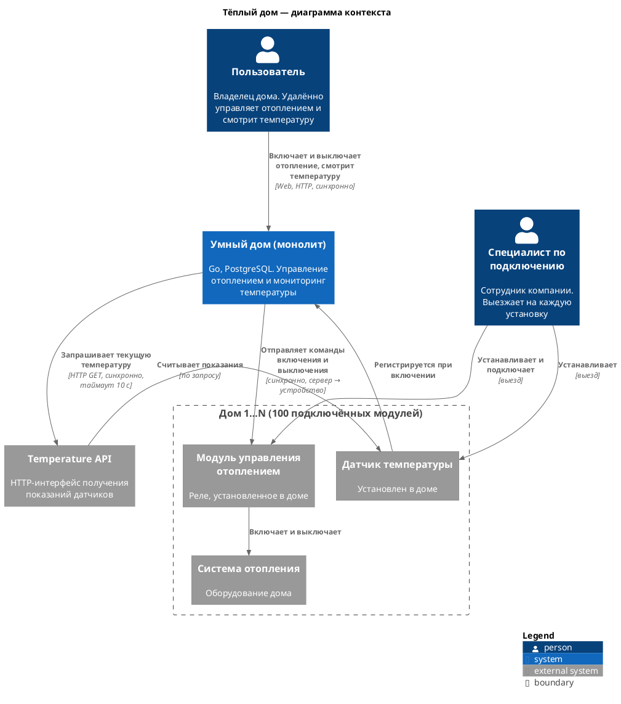
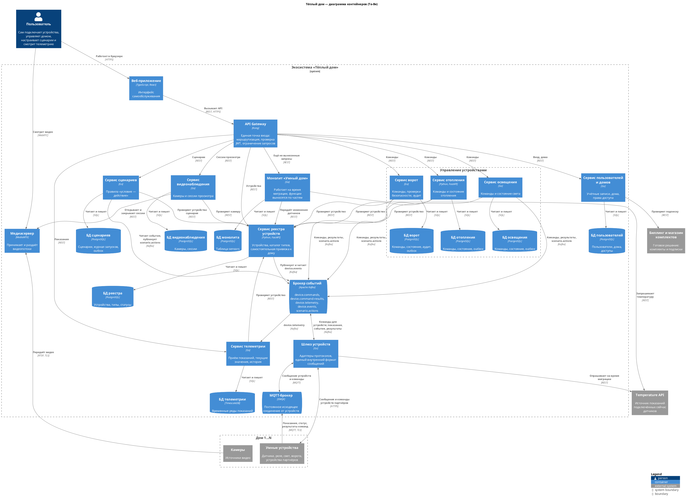
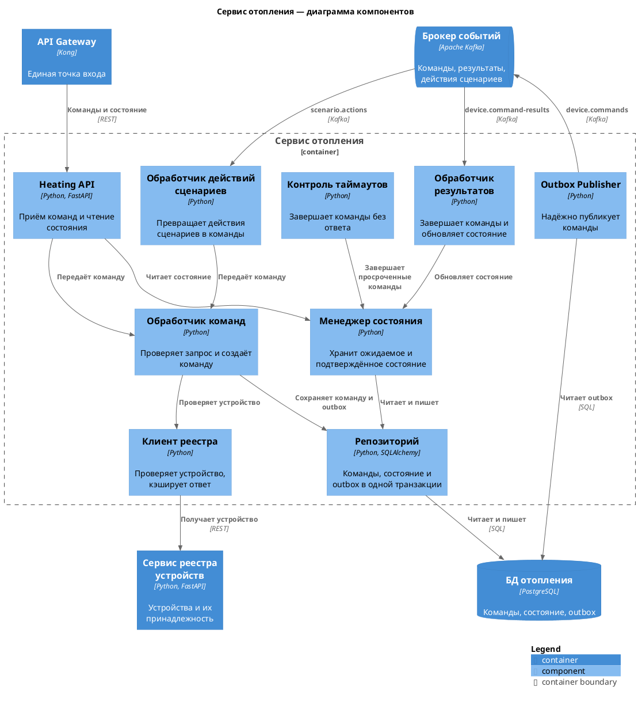
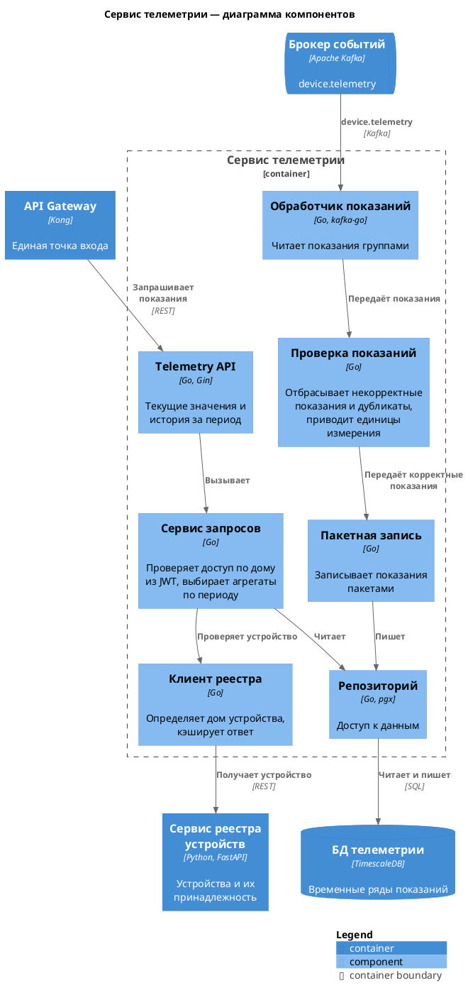
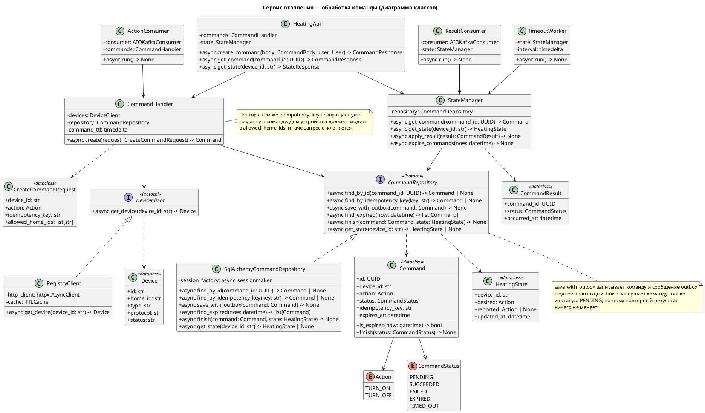
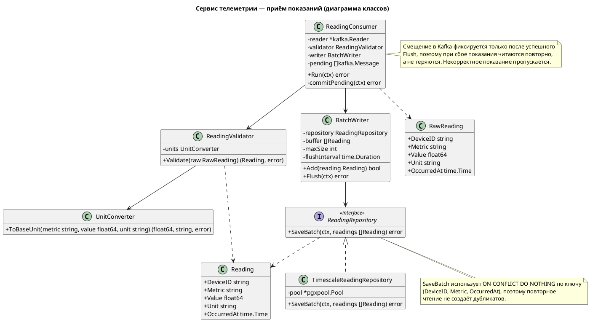
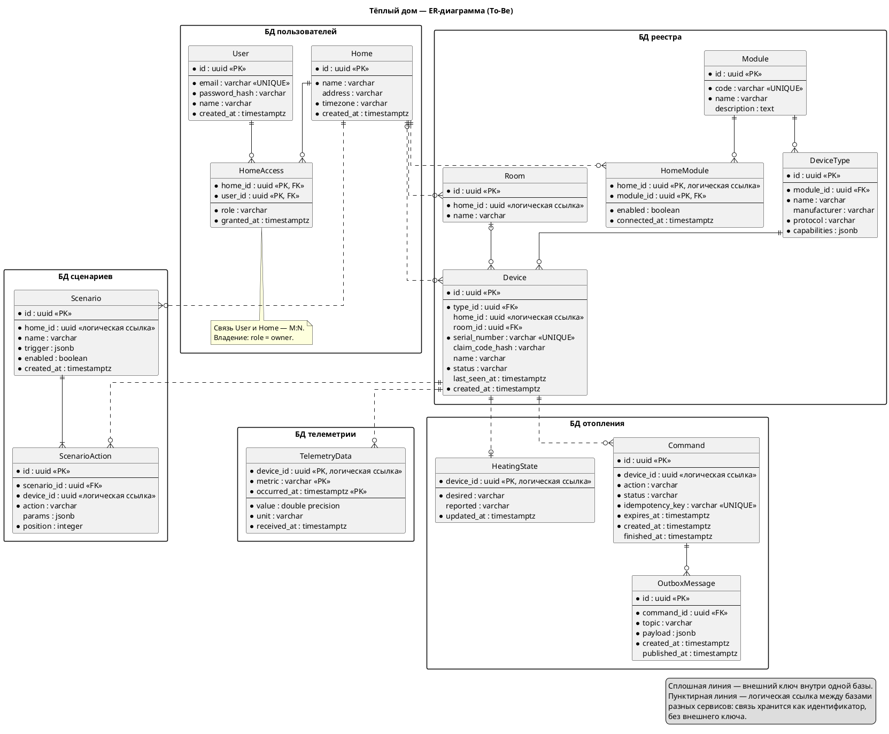

# Project_template

Это шаблон для решения проектной работы. Структура этого файла повторяет структуру заданий. Заполняйте его по мере работы над решением.

# Задание 1. Анализ и планирование

### 1. Описание функциональности монолитного приложения

**Управление отоплением:**

- Пользователи могут удалённо включать и выключать отопление в своём доме через веб-интерфейс.
- Система поддерживает передачу команд от сервера к модулю управления отоплением (реле). Инициатор управления всегда сервер, ответ ожидается синхронно.
- Система поддерживает автоматическую регистрацию датчиков при их включении.
- Подключить оборудование самостоятельно пользователь не может: каждая установка сопровождается выездом специалиста.

**Мониторинг температуры:**

- Пользователи могут просматривать текущую температуру в своём доме: по конкретному датчику, по списку датчиков и по названию помещения (`location`).
- Система поддерживает получение температуры по запросу: при каждом просмотре монолит обращается к Temperature API и подставляет свежее значение в ответ.
- Система поддерживает ведение списка датчиков (создание, просмотр, изменение, удаление) и запись последнего значения и статуса датчика.
- Система не хранит историю показаний: в таблице `sensors` есть только одно значение на датчик.

### 2. Анализ архитектуры монолитного приложения

| Характеристика | Текущее решение |
| --- | --- |
| Язык и фреймворк | Go 1.22, Gin |
| База данных | PostgreSQL 16, одна таблица `sensors`, доступ через `pgx` |
| Архитектура | Монолит: обработка запросов (`handlers`), бизнес-логика (`services`), работа с данными (`db`) и модели (`models`) находятся в одном приложении и одном процессе |
| Взаимодействие | Только синхронное |
| Работа с устройствами | Всё управление и чтение идёт от сервера к устройству. Температура запрашивается по HTTP у Temperature API с таймаутом 10 секунд. Со стороны устройства есть только регистрация при включении |
| Масштабируемость | Ограничена: монолит можно масштабировать только целиком, отдельно телеметрию или управление нельзя |
| Развёртывание | Требует деплоя всего приложения, поэтому любое обновление затрагивает все функции сразу |
| Текущая нагрузка | 100 веб-клиентов и 100 модулей управления отоплением |

### 3. Определение доменов и границы контекстов

| Домен | Тип | Ограниченный контекст | Ответственность | Ключевые понятия |
| --- | --- | --- | --- | --- |
| Управление устройствами | Основной | Реестр устройств | Регистрация устройств, привязка к дому и помещению, тип и статус подключения | Устройство, тип устройства, помещение |
| | | Управление отоплением | Включение и выключение отопления | Модуль отопления, команда, режим |
| | | Управление освещением | Включение и выключение света | Светильник, команда |
| | | Управление воротами | Запирание и отпирание ворот | Ворота, команда |
| | | Подключение устройств | Связь с устройствами партнёров по стандартным протоколам, перевод их сообщений во внутренний формат, поддержка ещё неизвестных датчиков | Протокол, адаптер, шлюз |
| Телеметрия | Основной | Сбор телеметрии | Приём показаний, текущие значения, история | Показание, метрика, временной ряд |
| Автоматизация | Основной | Сценарии | Пользовательские правила: условие и действие над устройством | Сценарий, триггер, действие |
| Видеонаблюдение | Вспомогательный | Наблюдение за домом | Удалённый просмотр дома (отдельно из-за другого профиля нагрузки: видеопоток, а не короткие сообщения) | Камера, видеопоток |
| Пользователи и дома | Вспомогательный | Учётные записи и дома | Регистрация, вход, дома и права доступа к ним | Пользователь, дом, доступ |
| Продажи и подписки | Общий | Комплекты и подписки | Модульные комплекты и подключение по модели SaaS | Комплект, модуль, подписка |

### **4. Проблемы монолитного решения**

- **Низкая устойчивость чтения.** `GET /api/v1/sensors` опрашивает датчики последовательно. При 100 датчиках и недоступном Temperature API один запрос может занять до 1000 секунд (100 × 10 секунд).
- **Скрытые сбои.** Если показание получить не удалось, ошибка только пишется в лог, а клиент получает ответ `200` с устаревшим значением из базы.
- **Нет истории и реактивности.** Показания запрашиваются только при просмотре и не сохраняются, поэтому нельзя смотреть телеметрию за период или запускать сценарии по событиям.
- **Нагрузка на устройства растёт вместе с числом просмотров.** Каждый просмотр порождает обращения к устройствам. Модель «сервер опрашивает датчик» плохо подходит для тысяч домов.
- **Нельзя масштабировать по частям.** Телеметрия, управление и видеонаблюдение нагружают систему по-разному, но ресурсы выделяются всему приложению сразу.
- **Нет расширяемости по типам устройств.** Логика привязана к типу `temperature` прямо в обработчиках запросов, поэтому поддержка света, ворот или неизвестных датчиков требует изменения и выкладки всего монолита.
- **Общая кодовая база.** Пять разработчиков будут менять одно приложение и выпускать его одним релизом, из-за чего изменения разных функций мешают друг другу.

### 5. Визуализация контекста системы — диаграмма С4



- Temperature API показан как внешняя система, потому что монолит обращается к нему только по адресу из настроек `TEMPERATURE_API_URL`.
- Регистрация датчика при включении — единственное взаимодействие, которое начинает устройство. Все остальные начинает сервер.

# Задание 2. Проектирование микросервисной архитектуры

### 1. Диаграмма контейнеров (Containers)



### 2. Диаграммы компонентов (Components)

Два микросервиса: отопление как часть управления устройствами и телеметрия.

#### Сервис отопления



#### Сервис телеметрии



### 3. Диаграммы кода (Code)

Наиболее критичные части этих двух сервисов.

#### Сервис отопления: обработка команды

Команда не должна потеряться или выполниться дважды, а её результат должен попасть в состояние устройства.



#### Сервис телеметрии: приём показаний

Через эту часть проходит весь поток показаний: при сбое они не должны теряться, а при повторном чтении дублироваться.



# Задание 3. Разработка ER-диаграммы

### Сущности

| Сущность | База данных | Назначение |
| --- | --- | --- |
| User | БД пользователей | Учётная запись пользователя |
| Home | БД пользователей | Дом: название, адрес и часовой пояс |
| HomeAccess | БД пользователей | Связь пользователя с домом и его роль, включая владельца (`owner`) |
| Module | БД реестра | Модуль экосистемы: отопление, освещение, ворота, наблюдение |
| HomeModule | БД реестра | Модули, которые пользователь подключил к дому |
| DeviceType | БД реестра | Тип устройства: модуль, протокол и возможности. Новый тип добавляется записью, а не изменением кода |
| Room | БД реестра | Помещение в доме. Заменяет `location` из монолита |
| Device | БД реестра | Конкретное устройство. `home_id` пуст, пока пользователь не привязал устройство. `status`: ожидает привязки, активно, не в сети, отключено |
| TelemetryData | БД телеметрии | Показание устройства. Первичный ключ исключает дубликаты при повторном чтении из Kafka |
| Command | БД отопления | Команда отоплению и её статус: `PENDING`, `SUCCEEDED`, `FAILED`, `EXPIRED`, `TIMED_OUT` |
| HeatingState | БД отопления | Ожидаемое и подтверждённое устройством состояние отопления |
| OutboxMessage | БД отопления | Сообщение, которое нужно опубликовать в Kafka |
| Scenario | БД сценариев | Пользовательский сценарий и его условие запуска |
| ScenarioAction | БД сценариев | Действие сценария над устройством |

Сервисы освещения и ворот хранят команды, состояние и outbox по той же схеме, что и сервис отопления, поэтому на диаграмме они не повторяются. Данные о сессиях видеонаблюдения служебные и к ключевым сущностям не относятся.

### ER-диаграмма

Пользователи и дома связаны отношением «многие ко многим» через `HomeAccess`: одним домом могут пользоваться несколько членов семьи, а один пользователь может владеть несколькими домами. Составной первичный ключ (`home_id`, `user_id`) исключает повторную привязку пользователя к тому же дому. Владение задаётся ролью `owner` в `HomeAccess`.

У каждого сервиса своя база, поэтому связи между базами хранятся как идентификаторы, без внешних ключей. Их целостность обеспечивают проверка устройства в реестре и события `device.events`.



# Задание 4. Создание и документирование API

### 1. Тип API

Система использует два типа API, потому что взаимодействие бывает двух видов.

| Тип | Где используется | Почему |
| --- | --- | --- |
| REST, документация OpenAPI | Запросы клиентов через API Gateway и проверка устройства в реестре | Клиенту нужен немедленный ответ: принята ли команда, какое сейчас состояние, какие есть показания |
| Асинхронный обмен через Kafka, документация AsyncAPI | Команды устройствам, результаты команд, показания и действия сценариев | Отправителю не нужно ждать ответа. Устройство может быть не в сети, а поток показаний не должен зависеть от доступности потребителей |

Команда объединяет оба типа: REST-запрос сразу возвращает `202` с идентификатором команды, команда доставляется через Kafka, а итоговый статус клиент получает отдельным запросом. Поэтому медленное или недоступное устройство не задерживает ответ клиенту.

### 2. Документация API

API описаны для двух реализуемых микросервисов: отопления и телеметрии.

| Сервис | Тип | Документация |
| --- | --- | --- |
| Сервис отопления | REST | [heating-openapi.yaml](schemas/api/heating-openapi.yaml) |
| Сервис отопления | Асинхронный | [heating-asyncapi.yaml](schemas/api/heating-asyncapi.yaml) |
| Сервис телеметрии | REST | [telemetry-openapi.yaml](schemas/api/telemetry-openapi.yaml) |
| Сервис телеметрии | Асинхронный | [telemetry-asyncapi.yaml](schemas/api/telemetry-asyncapi.yaml) |

**REST-эндпоинты:**

| Метод и путь | Назначение | Коды ответа |
| --- | --- | --- |
| `POST /api/v1/heating/devices/{device_id}/commands` | Отправить команду устройству | 202, 400, 401, 403, 404, 409, 500, 503 |
| `GET /api/v1/heating/commands/{command_id}` | Получить статус команды | 200, 401, 403, 404, 500 |
| `GET /api/v1/heating/devices/{device_id}/state` | Получить состояние отопления | 200, 401, 403, 404, 500 |
| `GET /api/v1/telemetry/devices/{device_id}/latest` | Получить последние показания | 200, 401, 403, 404, 500, 503 |
| `GET /api/v1/telemetry/devices/{device_id}/history` | Получить историю показаний за период | 200, 400, 401, 403, 404, 500, 503 |

**Топики Kafka:**

| Топик | Отправитель | Получатель | Содержимое |
| --- | --- | --- | --- |
| `device.commands` | Сервис отопления | Шлюз устройств | Команда устройству |
| `device.command-results` | Шлюз устройств | Сервис отопления | Результат команды |
| `scenario.actions` | Сервис сценариев | Сервис отопления | Действие сработавшего сценария |
| `device.telemetry` | Шлюз устройств | Сервис телеметрии | Новое показание устройства |

# Задание 5. Работа с docker и docker-compose

Приложение [temperature-api](apps/temperature-api) имитирует удалённый датчик. Порт по умолчанию — 8081.

| Запрос | Результат |
| --- | --- |
| `GET /temperature?location=` | Случайная температура для помещения |
| `GET /temperature?sensorId=` | Случайная температура для датчика |
| `GET /temperature/{id}` | Случайная температура для датчика. Этот запрос использует монолит в Get All Sensors |
| `GET /health` | Проверка работоспособности |

# **Задание 6. Разработка MVP**

| Микросервис | Язык | Порт | Логика |
| --- | --- | --- | --- |
| [heating-service](apps/heating-service) | Python, FastAPI | 8082 | Проверяет устройство в монолите, публикует команду и отслеживает её результат |
| [telemetry-service](apps/telemetry-service) | Go | 8083 | Читает показания из Kafka и хранит последние 100 для каждого датчика |
| [device-gateway](apps/device-gateway) | Go | Нет | Выполняет команды, меняя статус датчика в монолите, и раз в 5 секунд публикует показания датчиков |

В MVP монолит играет роль устройств: шлюз работает с ним по REST, а сервисы обмениваются событиями. Сам монолит не менялся, данные об устройствах пока остаются в нём.

| Топик | Отправитель | Получатель |
| --- | --- | --- |
| `device.commands` | heating-service | device-gateway |
| `device.command-results` | device-gateway | heating-service |
| `device.telemetry` | device-gateway | telemetry-service |

Команда выполняется асинхронно: `POST` сразу возвращает `202` со статусом `PENDING`, а итоговый статус нужно запросить отдельно.

### Проверка

```
# Создать устройство отопления и датчик температуры
curl -X POST localhost:8080/api/v1/sensors -H 'Content-Type: application/json' \
  -d '{"name": "Boiler", "type": "heating", "location": "Basement"}'
curl -X POST localhost:8080/api/v1/sensors -H 'Content-Type: application/json' \
  -d '{"name": "Room", "type": "temperature", "location": "Kitchen", "unit": "°C"}'

# Включить отопление: в ответе статус PENDING и id команды
curl -X POST localhost:8082/api/v1/heating/devices/1/commands \
  -H 'Content-Type: application/json' -d '{"action": "TURN_ON"}'

# Проверить результат: статус SUCCEEDED, а состояние устройства TURN_ON
curl localhost:8082/api/v1/heating/commands/{id}
curl localhost:8082/api/v1/heating/devices/1/state

# Через 5 секунд получить показания датчика
curl localhost:8083/api/v1/telemetry/devices/2/latest
curl localhost:8083/api/v1/telemetry/devices/2/history
```

В примере `id` равны 1 и 2 для пустой базы.
